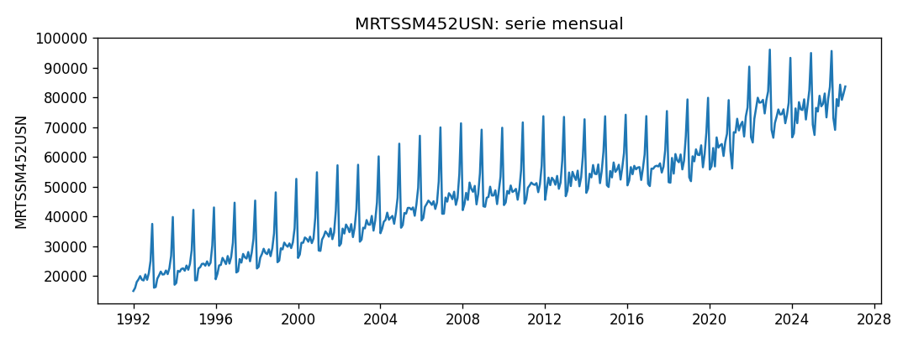
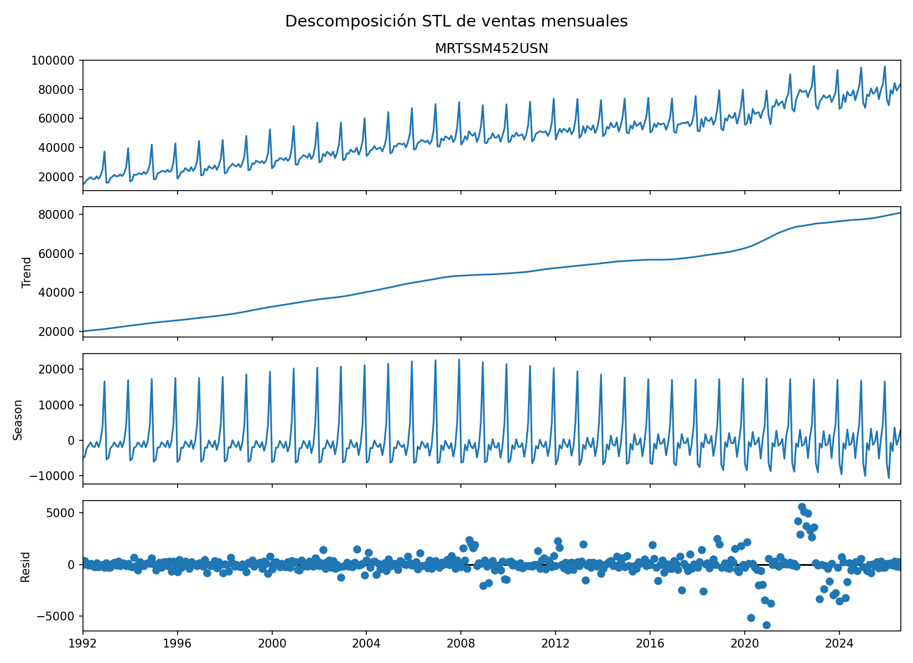
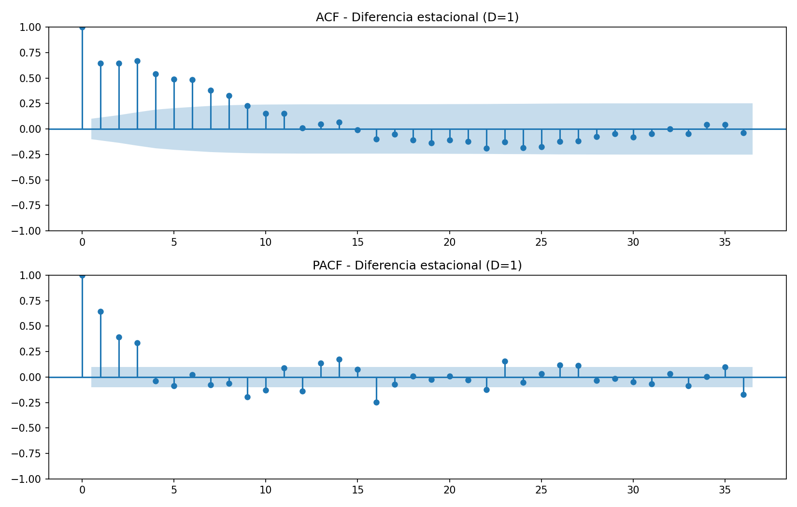
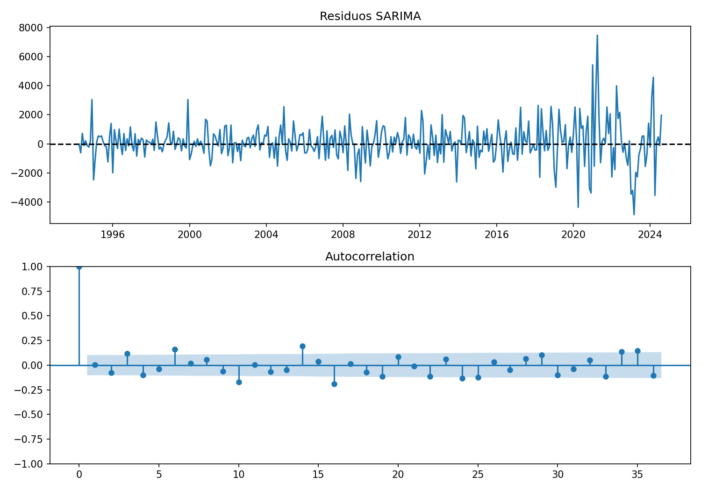

# Informe del miniproyecto 1

**Serie:** ventas mensuales de tiendas de mercancías generales de Estados Unidos (MRTSSM452USN).

**Curso:** Pronóstico de Series Temporales con IA — UAO, 2026-II.

## 1. La serie

Se analiza la serie **MRTSSM452USN**, correspondiente a ventas mensuales de tiendas de mercancías generales en Estados Unidos, expresadas en **millones de dólares**, sin ajuste estacional. La fuente es el *U.S. Census Bureau*, distribuida mediante Federal Reserve Economic Data (FRED), Federal Reserve Bank of St. Louis: [MRTSSM452USN](https://fred.stlouisfed.org/series/MRTSSM452USN). La ficha oficial incluye **“Public Domain: Citation Requested”**. Se atribuyen los datos al U.S. Census Bureau y su distribución a FRED; las condiciones y fuentes de respaldo se documentan en `datos/README.md`.

La muestra contiene **416 observaciones**, de **enero de 1992 a agosto de 2026**, con frecuencia mensual. La escogimos por su extensión y por la estacionalidad anual visible, especialmente en diciembre, que permite comparar métodos ingenuos, SARIMA y SARIMAX.

La carga mediante `cargar_serie` y la revisión inicial identificaron **cero meses vacíos**. No fue necesario imputar observaciones. Se observaron desviaciones importantes, particularmente alrededor de 2020–2024, pero no se dispone de evidencia de errores de registro que justifique sustituirlas. Por ello se conservaron los valores originales. La decisión aplicada en `preparar` y registrada en la columna `decision` es: **«Sin faltantes ni fechas duplicadas; se conservan los valores extremos observados»**. Los extremos no se recortaron porque podrían representar variaciones económicas reales.

## 2. Componentes

Se aplicó una descomposición **STL robusta** con periodo estacional de 12 meses, bajo el esquema aditivo:

$$Y_t=T_t+S_t+R_t,$$

donde $T_t$ es la tendencia, $S_t$ la componente estacional y $R_t$ el residuo.

La tendencia estimada aumenta de **20.015,40** a **80.982,93 millones de dólares** entre el inicio y el final de la muestra, un incremento aproximado de **304,4 %**. El promedio del componente estacional es más alto en **diciembre (+18.857,60 millones)** y más bajo en **febrero (−6.592,12 millones)**. Esto concuerda con los picos de diciembre observados en la serie. El mayor residuo en valor absoluto ocurre en **diciembre de 2020 (−5.850,21 millones)**. Su magnitud señala una observación inusual respecto a la descomposición, no necesariamente un error de medición.

## 3. Líneas base y backtest

Se empleó la función `backtest` suministrada en `comun.py`, sin modificarla. Utiliza los **últimos 24 meses como ventana de evaluación**, desde **septiembre de 2024 hasta agosto de 2026**, con horizonte de **12 meses**. Como cada origen necesita doce valores futuros observados, se obtienen **13 orígenes móviles**, desde agosto de 2024 hasta agosto de 2025. Las métricas se calculan en cada origen y después se promedian.

El modelo ingenuo predice el último valor disponible, $\hat Y_{t+h\mid t}=Y_t$. El estacional ingenuo repite el valor del mismo mes del año anterior, $\hat Y_{t+h\mid t}=Y_{t+h-12}$, para $h=1,\ldots,12$.

Las métricas empleadas son:

$$\mathrm{MAE}=\frac{1}{n}\sum_{i=1}^{n}|y_i-\hat y_i|,$$

$$\mathrm{RMSE}=\sqrt{\frac{1}{n}\sum_{i=1}^{n}(y_i-\hat y_i)^2},$$

$$\mathrm{MAPE}=\frac{100}{n}\sum_{i=1}^{n}\left|\frac{y_i-\hat y_i}{y_i}\right|.$$

| Línea base | RMSE | MAE | MAPE (%) |
|---|---:|---:|---:|
| Ingenuo | 8.601,76 | 6.875,18 | 8,66 |
| Estacional ingenuo | **2.181,36** | **1.904,40** | **2,44** |

El **estacional ingenuo** gana en las tres métricas. Su RMSE es aproximadamente **74,64 % menor** que el del ingenuo. Esta diferencia confirma la importancia predictiva del ciclo anual.

En cada origen, las funciones de pronóstico reciben exclusivamente la serie de entrenamiento disponible hasta esa fecha. Las variables exógenas futuras se obtienen del calendario, no de ventas observadas posteriormente. Para evitar utilizar el periodo de evaluación en la búsqueda por AIC, la rejilla se ajustó sobre los **primeros 392 meses**.

## 4. Estacionariedad e identificación

Se aplicó la prueba aumentada de Dickey–Fuller (ADF) a cuatro versiones de la serie. Para la original se incluyeron constante y tendencia (`regression="ct"`), y para las diferencias se incluyó constante (`regression="c"`). La hipótesis nula es la presencia de raíz unitaria.

| Serie evaluada | Estadístico ADF | Valor p | Decisión al 5 % |
|---|---:|---:|---|
| Original | −3,1282 | 0,099675 | No rechazar la nula |
| Diferencia regular | −3,6385 | 0,005066 | Rechazar la nula |
| Diferencia estacional (12) | −4,5275 | 0,000175 | Rechazar la nula |
| Ambas diferencias | −5,6908 | 8,081711 × 10⁻⁷ | Rechazar la nula |

Estos valores, la ACF/PACF y la selección por AIC se calcularon exclusivamente sobre los **primeros 392 meses, de enero de 1992 a agosto de 2024**. Los últimos 24 meses se reservan para la evaluación. En los orígenes posteriores del backtest se incorporan únicamente las observaciones ya disponibles, conforme al protocolo común. La gráfica de la serie y la STL completa son descriptivas: sus componentes no se usan para transformar datos, identificar órdenes ni ajustar pronósticos. Los rezagos seleccionados por AIC en las cuatro pruebas ADF fueron 14, 13, 16 y 14, respectivamente.

Se adoptó **$d=0$ y $D=1$** como especificación de trabajo: la diferencia estacional por sí sola rechaza la hipótesis de raíz unitaria y elimina gran parte del ciclo anual. La diferencia regular también la rechaza, por lo que añadir ambas diferencias no es obligatorio y podría sobrediferenciar la serie. La transformación elegida es:

$$W_t=(1-B^{12})Y_t=Y_t-Y_{t-12}.$$

En la **ACF de la diferencia estacional**, los primeros rezagos muestran autocorrelaciones positivas y persistentes: aproximadamente **0,64 en el rezago 1**, **0,64 en el 2** y **0,67 en el 3**. En la **PACF** sobresalen los rezagos **1, 2 y 3** (aproximadamente 0,64, 0,39 y 0,33), además de otros picos posteriores. Los primeros picos superan las bandas de confianza dibujadas. Esto indica dependencia que todavía debe modelarse; rechazar la raíz unitaria no significa ausencia de autocorrelación. Se mantiene provisionalmente $d=0,D=1$: ADF respalda la diferencia estacional y no obliga a añadir una diferencia regular. ADF no es una prueba específica de raíces estacionales ni demuestra que esta sea la única diferenciación posible. Los órdenes AR y MA se contrastan mediante la rejilla AIC, sin deducirlos mecánicamente de un solo pico.

## 5. Modelos clásicos

En las gráficas anteriores, entre los rezagos 1 y 36, la ACF supera sus bandas del 95 % en los rezagos 1–8; la PACF lo hace en 1, 2, 3, 9, 10, 12, 13, 14, 16, 22, 23, 26, 27 y 36. La ACF se atenúa tras los primeros rezagos y no muestra persistencia cercana a uno en todo el rango. Junto con ADF, esto respalda conservar la diferenciación provisional. Las bandas son puntuales: los picos aislados no determinan automáticamente el orden del modelo.

Se evaluó una rejilla de **36 combinaciones**: $p,q\in\{0,1,2\}$ y $P,Q\in\{0,1\}$, con $d=0$, $D=1$ y periodo estacional $s=12$. Se ajustó sobre los primeros **392 meses**, y se ordenaron los modelos convergentes por el criterio de información de Akaike (AIC).

| Orden regular | Orden estacional | AIC |
|---|---|---:|
| (1,0,2) | (1,1,1,12) | **6.286,64** |
| (2,0,2) | (1,1,1,12) | 6.288,05 |
| (1,0,2) | (0,1,1,12) | 6.290,32 |
| (2,0,2) | (0,1,1,12) | 6.290,73 |
| (2,0,1) | (1,1,1,12) | 6.303,88 |

El menor AIC correspondió a **SARIMA$(1,0,2)(1,1,1)_{12}$**. Su forma multiplicativa, sin término determinista de tendencia, puede escribirse como:

$$(1-\phi_1B)(1-\Phi_1B^{12})(1-B^{12})Y_t=(1+\theta_1B+\theta_2B^2)(1+\Theta_1B^{12})\varepsilon_t.$$

Los coeficientes se estiman con los datos de entrenamiento. La elección por AIC no implica por sí misma que los residuos sean ruido blanco ni garantiza el menor error de pronóstico.

En el SARIMA seleccionado, los residuos fluctúan alrededor de cero, pero muestran **mayor dispersión en el tramo posterior a 2020**. El diagnóstico utiliza el ajuste sobre los 392 meses de selección. Se excluyen **27 residuos iniciales**, tomando el máximo entre `loglikelihood_burn` y `nobs_diffuse`, y quedan 365 residuos. La ACF residual conserva picos fuera de las bandas. Se aplicó Ljung–Box con **`model_df=5`**, pues $p+q+P+Q=1+2+1+1=5$; los grados de libertad son 7 y 19 para los rezagos 12 y 24. Los resultados se guardan en `resultados/ljung_box.csv`:

| Rezago | Estadístico Ljung–Box | Valor p |
|---|---:|---:|
| 12 | 36,800582 | 5,116744 × 10⁻⁶ |
| 24 | 89,822566 | 3,566144 × 10⁻¹¹ |

En ambos casos se rechaza al 5 % la hipótesis nula de ausencia de autocorrelación conjunta hasta el rezago correspondiente. Por ello, **los residuos no son compatibles con ruido blanco** según este diagnóstico. Este es un límite del ajuste, aunque su desempeño predictivo puede seguir siendo útil.

Para SARIMAX se agregó una variable exógena: **número de días de lunes a viernes de cada mes**, sin descontar festivos oficiales. Esta variable es calculable con anticipación mediante el calendario, tanto en entrenamiento como para los doce meses pronosticados, por lo que no introduce fuga de ventas futuras. SARIMAX mantuvo los órdenes seleccionados para SARIMA y añadió dicha regresora.

En el backtest, SARIMAX alcanzó **RMSE 1.082,02**, frente a **1.102,38** de SARIMA: una reducción de aproximadamente **1,85 %**. La ganancia es pequeña, pero consistente también con menores MAE y MAPE en las cifras reportadas.

## 6. Tabla de métricas

La tabla corresponde a `resultados/metricas.csv`, ordenada por RMSE creciente. Los errores RMSE y MAE se expresan en **millones de dólares**; MAPE, en porcentaje.

La ejecución completa verifica la convergencia en cada ajuste y deja el registro en `resultados/convergencia.csv`. Los 13 ajustes SARIMA y los 13 SARIMAX del backtest convergieron con un máximo de 100 iteraciones permitido; no se descartaron orígenes, no se sustituyeron modelos y no se cambiaron las métricas ni el backtest de `comun.py`. Las advertencias del optimizador permanecen visibles. Si un ajuste del backtest no converge en otra ejecución, el guion registra el fallo y se detiene, en lugar de publicar una nueva tabla incompleta.

También convergieron los 36 candidatos de la rejilla y el ajuste del diagnóstico. La validación local se realizó con Python 3.11, NumPy 2.4.2, pandas 2.3.3, matplotlib 3.10.8 y statsmodels 0.14.6. `requirements.txt` declara estas dependencias sin fijar versiones; por ello, se documenta el entorno verificado y no se presupone identidad numérica entre versiones distintas.

| Modelo | Decisión | RMSE | MAE | MAPE (%) |
|---|---|---:|---:|---:|
| SARIMAX(1,0,2)(1,1,1,12) + exógenas | Sin faltantes ni fechas duplicadas; se conservan los valores extremos observados | **1.082,02** | **890,76** | **1,16** |
| SARIMA(1,0,2)(1,1,1,12) | Sin faltantes ni fechas duplicadas; se conservan los valores extremos observados | 1.102,38 | 907,45 | 1,17 |
| Estacional ingenuo | Sin faltantes ni fechas duplicadas; se conservan los valores extremos observados | 2.181,36 | 1.904,40 | 2,44 |
| Ingenuo | Sin faltantes ni fechas duplicadas; se conservan los valores extremos observados | 8.601,76 | 6.875,18 | 8,66 |

## 7. Conclusión

El mejor modelo clásico por RMSE en este experimento fue **SARIMAX$(1,0,2)(1,1,1)_{12}$ con número de días de lunes a viernes como exógena**. Frente a la mejor línea base, el estacional ingenuo, redujo el **RMSE en 50,40 %**, el **MAE en 53,23 %** y el **MAPE en 52,46 %**, calculados como $100(M_{\mathrm{base}}-M_{\mathrm{modelo}})/M_{\mathrm{base}}$ a partir de las métricas redondeadas.

La ganancia de SARIMAX respecto a SARIMA fue bastante menor (aproximadamente **1,85 % en RMSE**), de modo que la estructura autorregresiva y estacional explica la mayor parte de la mejora. Los errores residuales del SARIMA son especialmente variables alrededor de **2020–2024**, periodo en el que el comportamiento de la serie parece menos estable; la gráfica no permite atribuir una causa única a esas desviaciones. El Ljung–Box significativo advierte que queda dependencia sin explicar.

El resultado muestra que **un buen pronóstico en backtest y un diagnóstico residual satisfactorio son criterios diferentes**. El SARIMAX seleccionado constituye la referencia clásica que el miniproyecto 2 deberá intentar superar, siempre con el mismo protocolo de evaluación.
